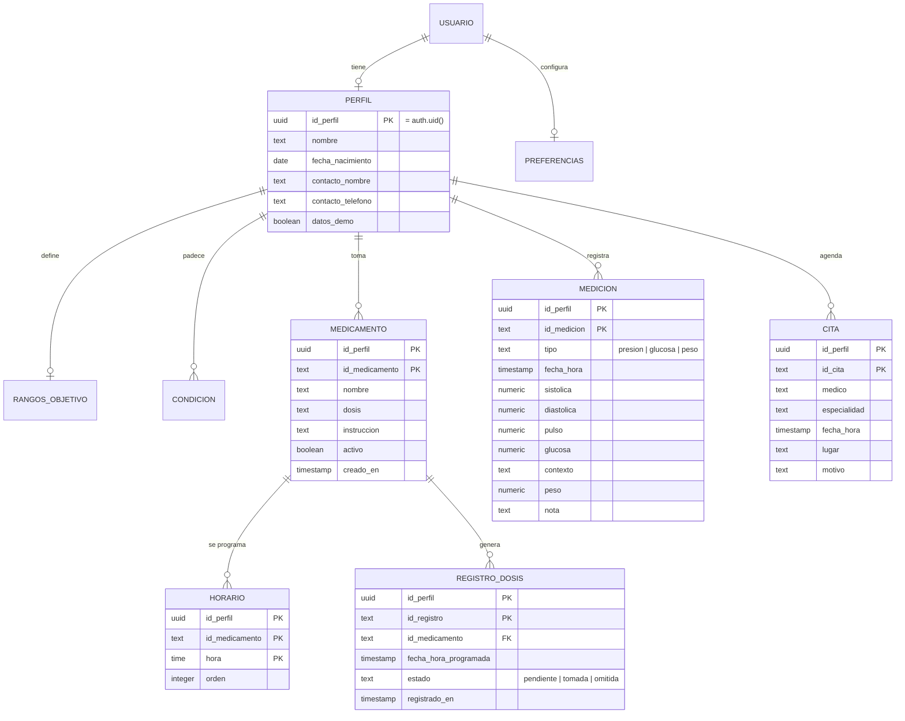

# Pulso

### Tu libreta de salud, siempre contigo

Aplicación web progresiva (PWA) para personas con **hipertensión y diabetes tipo 2**: recuerda las dosis y registra cuáles se tomaron, guarda la presión, la glucosa y el peso comparándolos con el rango que definió el médico, y genera un informe imprimible para llevar a la consulta.

**Instituto Tecnológico de Las Américas (ITLA)** · Interacción Humano-Computadora · Sección 2026-C-2
Facilitadora: Eduandy Isabel Cruz Abreu

| Integrante | Matrícula |
|---|---|
| Jezel Pujols | 2025-2067 |
| Rebeca Mary Astacio Bryan | 2025-2264 |

> **Aviso de salud.** Pulso es un prototipo académico. **No diagnostica, no prescribe y no ajusta tratamientos.** Los datos de demostración («María Fernández») son ficticios.

---

## Contenido

1. [Módulos que funcionan](#módulos-que-funcionan)
2. [Instalación y ejecución](#instalación-y-ejecución)
3. [Arquitectura](#arquitectura)
4. [Estructura del proyecto](#estructura-del-proyecto)
5. [Base de datos (Supabase)](#base-de-datos-supabase)
6. [Sincronización y modo sin conexión](#sincronización-y-modo-sin-conexión)
7. [Pruebas](#pruebas)
8. [Comandos](#comandos)
9. [Stack](#stack)

---

## Módulos que funcionan

Todos guardan en la base de datos de Supabase, y cada usuario solo ve sus propios datos.

| Módulo | Qué hace | Pantallas | Tablas |
|---|---|---|---|
| **1. Usuarios y sesión** | Crear cuenta e iniciar sesión con correo y contraseña, cerrar sesión, cambiar la contraseña y eliminar la cuenta con todos sus datos | `/entrar`, `/ajustes` | `auth.users` (Supabase Auth) |
| **2. Perfil** | Configuración inicial en 3 pasos: nombre, condiciones, contacto de emergencia y rangos objetivo que define el médico | `/bienvenida`, `/ajustes` | `perfil`, `condicion`, `rangos_objetivo`, `preferencias` |
| **3. Medicamentos y dosis** | Alta, edición, desactivación y borrado de medicamentos con sus horarios; marcar cada dosis como tomada u omitida con «Deshacer»; cinta del día y adherencia | `/`, `/medicamentos` | `medicamento`, `horario`, `registro_dosis` |
| **4. Mediciones** | Registrar presión, glucosa y peso en 3 toques; clasificación contra el rango del médico; historial con tendencias | `/registrar`, `/historial` | `medicion` |
| **5. Citas e informe** | Citas médicas con exportación al calendario (.ics) e informe A4 para el médico | `/citas`, `/informe` | `cita` |

---

## Instalación y ejecución

### Requisitos

- **Node.js 20 o superior** (probado con Node 24) y npm.
- Una cuenta gratuita de **[Supabase](https://supabase.com)** para la base de datos. La CLI de Supabase viene incluida en el proyecto como dependencia de desarrollo (`npx supabase`), no hace falta instalarla aparte.

### 1. Clonar e instalar

```bash
git clone https://github.com/ImJezel/pulso.git
cd pulso
npm install
```

### 2. Crear la base de datos

1. Crea un proyecto en [supabase.com/dashboard](https://supabase.com/dashboard) y guarda la contraseña de la base de datos.
2. Copia el archivo de ejemplo de variables de entorno:

   ```bash
   cp .env.example .env.local
   ```

3. En Supabase, abre **Project Settings → API** y copia en `.env.local` la **Project URL** (`VITE_SUPABASE_URL`) y la clave **publishable** o **anon** (`VITE_SUPABASE_ANON_KEY`). Esa clave es pública por diseño: lo que protege los datos es Row Level Security.
4. Aplica el esquema y la configuración de autenticación con la CLI:

   ```bash
   npx supabase login
   npx supabase link --project-ref TU_PROJECT_REF
   npx supabase db push
   npx supabase config push
   ```

   `db push` crea las 9 tablas, las políticas de seguridad y la función para eliminar la cuenta (`supabase/migrations/`). `config push` desactiva la confirmación por correo y pide contraseñas de 8 caracteres o más (`supabase/config.toml`).

> **Sin la CLI:** pega el contenido de `supabase/migrations/20261027010000_esquema_inicial.sql` en el **SQL Editor** de Supabase y ejecútalo. Luego, en **Authentication → Sign In / Providers → Email**, desactiva **Confirm email**.

### 3. Ejecutar

```bash
npm run dev
```

Se abre en `http://localhost:5173`. Crea una cuenta, completa los 3 pasos de bienvenida y, si quieres ver la app llena, ve a **Ajustes → Cargar datos de ejemplo**.

### Versión de producción

```bash
npm run build     # PWA instalable, en dist/
npm run preview   # la sirve en http://localhost:4173
```

### Sin base de datos

Si `.env.local` no existe o sus variables están vacías, Pulso funciona en **modo local**: sin cuentas y con los datos solo en el navegador, como el prototipo original. `npm run dev:local` (modo `sincuenta` de Vite) fuerza ese modo aunque haya variables, y es el que usan las herramientas de evidencia (`recorrido`, `axe`, `capturas`).

---

## Arquitectura

**Monolito del lado del cliente organizado en capas**, con Supabase como backend gestionado (Postgres + Auth). Cada capa solo conoce a la de abajo:

```
┌──────────────────────────────────────────────────────────────────────┐
│ 1. Presentación        src/pages · src/components                    │
│    React + react-router-dom · Tailwind con tokens · lucide · Recharts│
├──────────────────────────────────────────────────────────────────────┤
│ 2. Estado y sesión     src/context                                   │
│    AppContext (useReducer, Deshacer) · SesionContext (Supabase Auth) │
│    useSincronizacion (cola offline-first hacia la base de datos)     │
├──────────────────────────────────────────────────────────────────────┤
│ 3. Dominio             src/lib — funciones puras, probadas sin red   │
│    rangos · adherencia · fechas · ics · demo                         │
├──────────────────────────────────────────────────────────────────────┤
│ 4. Datos               src/lib/storage.ts  → localStorage (copia)    │
│                        src/lib/remoto.ts   → Supabase (9 tablas)     │
└──────────────────────────────────────────────────────────────────────┘
                    │ HTTPS (supabase-js, clave pública + JWT del usuario)
                    ▼
        Supabase: Postgres con Row Level Security · Auth
```

Las pantallas **no saben que existe una base de datos**: siguen trabajando con un solo objeto `EstadoPulso`. Por eso añadir Supabase no obligó a tocar ninguna pantalla de datos (Hoy, Registrar, Medicamentos, Historial, Citas, Informe).

---

## Estructura del proyecto

```
pulso/
├── index.html
├── package.json
├── project.config.json        ← datos institucionales en un solo sitio
├── vite.config.ts             ← build de la PWA y de un solo archivo
├── .env.example               ← plantilla de variables de entorno
│
├── supabase/
│   ├── config.toml            ← configuración de Auth (sin confirmación, contraseña ≥ 8)
│   └── migrations/            ← el esquema de la base de datos, en SQL
│
├── src/
│   ├── main.tsx               ← punto de entrada y registro del service worker
│   ├── App.tsx                ← sesión → datos del usuario → rutas
│   ├── types/
│   │   ├── index.ts           ← el modelo de datos de la app
│   │   └── supabase.ts        ← tipos generados del esquema (npm run db:tipos)
│   ├── context/
│   │   ├── AppContext.tsx     ← estado global, Deshacer, anuncios accesibles
│   │   ├── SesionContext.tsx  ← crear cuenta, entrar, salir, eliminar cuenta
│   │   └── useSincronizacion.ts ← envío de cambios y modo sin conexión
│   ├── lib/
│   │   ├── supabase.ts        ← cliente de Supabase
│   │   ├── remoto.ts          ← estado ⇄ tablas, cálculo de cambios, consultas
│   │   ├── storage.ts         ← copia local por usuario
│   │   ├── rangos.ts          ← clasificación contra los rangos del médico
│   │   ├── adherencia.ts      ← dosis del día, cinta y % de cumplimiento
│   │   ├── fechas.ts · ics.ts · demo.ts · calidadISO.ts
│   ├── components/            ← 10 componentes accesibles reutilizables
│   ├── pages/                 ← una por pantalla (10)
│   └── styles/tokens.css      ← el sistema de diseño
│
├── tests/                     ← pruebas unitarias (sin red)
│   └── integracion/           ← pruebas contra la base de datos real
└── scripts/                   ← recorrido de usuario, auditoría axe y capturas
```

### Pantallas

| Ruta | Archivo | Qué resuelve |
|---|---|---|
| `/entrar` | `pages/Entrar.tsx` | Iniciar sesión o crear una cuenta |
| `/bienvenida` | `pages/Bienvenida.tsx` | Configuración inicial en 3 pasos |
| `/` | `pages/Hoy.tsx` | Qué toca ahora, cinta del día, última medición y próxima cita |
| `/registrar` | `pages/Registrar.tsx` | Registrar una medición en 3 toques |
| `/medicamentos` | `pages/Medicamentos.tsx` | Alta, edición, desactivación y borrado |
| `/historial` | `pages/Historial.tsx` | Tendencias, resumen del período y tabla |
| `/citas` | `pages/Citas.tsx` | Próximas y pasadas, con exportación a calendario |
| `/informe` | `pages/Informe.tsx` | El documento A4 para el médico |
| `/ajustes` | `pages/Ajustes.tsx` | Accesibilidad, perfil, cuenta, datos y aviso de alcance |
| `/calidad` | `pages/Calidad.tsx` | Radar de calidad ISO 25010 |

---

## Base de datos (Supabase)

El esquema completo está en [`supabase/migrations/20261027010000_esquema_inicial.sql`](supabase/migrations/20261027010000_esquema_inicial.sql) y traduce el modelo relacional del Entregable 2.



| Decisión | Por qué |
|---|---|
| **Row Level Security en las 9 tablas** | Una política por tabla: una fila se puede leer o escribir solo si `id_perfil = auth.uid()`. Aunque alguien modifique el código del navegador, Postgres no le deja tocar los datos de otro paciente. El rol anónimo no tiene ningún permiso. |
| **Claves primarias compuestas `(id_perfil, id)`** | Los identificadores los genera la app en el dispositivo (así funciona sin conexión); con el usuario en la clave nunca chocan entre cuentas. Las claves foráneas también incluyen `id_perfil`, así que nadie puede colgar una dosis de un medicamento ajeno. |
| **`timestamp` sin zona horaria** | Igual que la app: una medición de las 8:00 a. m. no se mueve de día al cambiar de zona horaria. |
| **`ON DELETE CASCADE`** | Borrar un medicamento borra sus horarios y dosis; eliminar la cuenta borra todo. |
| **`eliminar_mi_cuenta()`** | Función `SECURITY DEFINER` que solo puede borrar al usuario que la llama. El navegador nunca tiene la clave de servicio. |

Si cambias el esquema, crea una migración nueva en `supabase/migrations/`, aplícala con `npm run db:push` y regenera los tipos con `npm run db:tipos`.

---

## Sincronización y modo sin conexión

Pulso se abre varias veces al día, muchas veces sin buena señal. Por eso la base de datos no está en el camino de cada toque:

1. Cada cambio se aplica al instante en pantalla y se guarda en una **copia local del usuario** (`localStorage`, una clave por cuenta).
2. `useSincronizacion` guarda **lo último que el servidor confirmó** y, 400 ms después de cada cambio, envía **solo la diferencia** (`calcularCambios` en `remoto.ts`).
3. **Sin internet** no se pierde nada: la base confirmada no avanza, así que el siguiente intento incluye todo lo pendiente. Se reintenta al volver la conexión y cada 30 segundos, y la app lo dice con calma («Sin conexión. Lo que registres se guarda en este dispositivo…»).
4. **Al abrir**, primero se sube lo pendiente y después se trae lo del servidor. En el orden contrario, lo del servidor pisaría lo que se hizo sin conexión.
5. **Al cerrar sesión** se intenta subir lo pendiente; si no se puede, la app avisa antes de borrar la copia local.

---

## Pruebas

```bash
npm test                    # 69 pruebas unitarias, sin red
npm run test:integracion    # 6 pruebas contra la base de datos real
```

| Archivo | Qué comprueba |
|---|---|
| `tests/rangos.test.ts` | Clasificación de mediciones; sin rangos no se colorea nada |
| `tests/adherencia.test.ts` | Porcentaje de cumplimiento y dosis del día |
| `tests/fechas.test.ts` | Formatos en español dominicano y cálculo de edad |
| `tests/storage.test.ts` | JSON corrupto, estado viejo, reducer |
| `tests/remoto.test.ts` | Estado ⇄ filas sin pérdida y cálculo exacto de cambios |
| `tests/sincronizacion.test.tsx` | Orden de operaciones: subir antes de traer, no pisar cambios sin conexión, cambios durante un envío |
| `tests/integracion/supabase.test.ts` | Contra Supabase real: guarda y devuelve el caso completo, envía solo diferencias, es idempotente y **RLS impide que un usuario vea, cambie o borre datos de otro** |

Las pruebas de integración crean dos usuarios de prueba y los eliminan al terminar. Necesitan `.env.local` configurado y la confirmación por correo desactivada.

---

## Comandos

| Comando | Qué hace |
|---|---|
| `npm run dev` | Servidor de desarrollo con Supabase |
| `npm run dev:local` | Servidor de desarrollo en modo local, sin cuentas |
| `npm run build` | Build de producción (PWA) en `dist/` |
| `npm run build:unico` | Un solo `index.html` que abre con doble clic, en modo local |
| `npm run preview` | Sirve el build de producción |
| `npm test` | Pruebas unitarias |
| `npm run test:integracion` | Pruebas contra la base de datos real |
| `npm run lint` | Análisis estático con oxlint |
| `npm run db:push` | Aplica las migraciones al proyecto enlazado |
| `npm run db:tipos` | Regenera `src/types/supabase.ts` desde el esquema |
| `npm run recorrido` · `axe` · `capturas` | Con `npm run dev:local` corriendo: recorrido de un usuario nuevo, auditoría de accesibilidad y capturas |

---

## Stack

| Herramienta | Para qué |
|---|---|
| **React 19 + TypeScript** | Diez pantallas que comparten un mismo estado; TypeScript documenta el modelo y evita errores de tipo en registros clínicos |
| **Vite** | Servidor de desarrollo y build estático |
| **Supabase** (Postgres + Auth) | Base de datos con seguridad por fila y cuentas de usuario, sin mantener un servidor propio |
| **@supabase/supabase-js** | Cliente tipado con los tipos generados del esquema |
| **Tailwind CSS 4** | Estilos con tokens; el alto contraste solo cambia variables CSS |
| **React Context + `useReducer`** | Un solo objeto de estado; Redux sería sobreingeniería |
| **vite-plugin-pwa** | Instalable y funcional sin conexión |
| **Recharts · date-fns · lucide-react · react-router-dom** | Gráficos accesibles, fechas en español, íconos y rutas |
| **Vitest + Testing Library** | Pruebas unitarias, del motor de sincronización y de integración |

---

Proyecto académico sin fines comerciales, desarrollado para el Instituto Tecnológico de Las Américas (ITLA).
